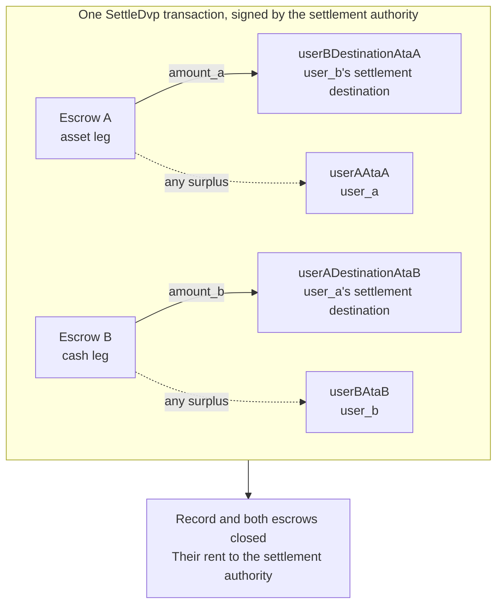

`SettleDvp` được ký bởi settlement authority có tên trong bản ghi giao dịch. Trong
một transaction, lệnh này chuyển `amount_a` của vế tài sản đến địa chỉ đích của
bên giữ vế tiền mặt và `amount_b` của vế tiền mặt đến địa chỉ đích của bên giữ
vế tài sản, hoàn lại phần dư trong mỗi escrow cho bên của vế đó, rồi đóng bản ghi
cùng cả hai escrow. Nếu bất kỳ khoản chuyển nào không thể hoàn tất, lệnh sẽ
thất bại và không có gì được di chuyển.

Trang này tiếp nối từ [tạo giao dịch](/docs/defi/dvp-program/create-a-trade)
và [nạp vốn cho các vế](/docs/defi/dvp-program/fund-the-legs); client, các signer,
`trade` và các token account của các bên được giữ nguyên.

## Xác thực lại trước khi ký

Settlement authority ký transaction chuyển cả hai vế, vì vậy nó thực hiện cùng
bước đọc kiểm tra như mỗi bên trước khi ký: chủ sở hữu, kích thước, các bên, các
mint, số lượng, thời hạn và cả hai địa chỉ đích (xem
[nạp vốn cho các vế](/docs/defi/dvp-program/fund-the-legs#verify-the-terms)). Bản thân
chương trình cũng kiểm tra lại khi quyết toán rằng mỗi mint vẫn thuộc về token
program đã ghi nhận lúc tạo, không mang extension bị chặn, và có cùng mint
authority như khi giao dịch được tạo. Do đó, một mint được tạo lại với extension
bị chặn, token program khác hoặc mint authority khác sẽ không thể quyết toán.

## Tạo các tài khoản nhận

Lệnh Settle ghi vào bốn token account mà chương trình không tự tạo:

| Tài khoản                | Nhận                     | Chủ sở hữu                           |
| ---------------------- | ---------------------------- | ------------------------------- |
| `userADestinationAtaB` | Vế tiền mặt (`amount_b`)    | `user_a_settlement_destination` |
| `userBDestinationAtaA` | Vế tài sản (`amount_a`)   | `user_b_settlement_destination` |
| `userAAtaA`            | Phần dư của vế tài sản | `user_a`                        |
| `userBAtaB`            | Phần dư của vế tiền mặt  | `user_b`                        |

Các tài khoản nhận phần dư chỉ được dùng khi escrow chứa nhiều hơn số lượng đã
thỏa thuận, nhưng bất kỳ ai nắm giữ mint đều có thể tạo ra phần dư bằng cách gửi
vài đơn vị cơ sở vào escrow. Nếu tài khoản hoàn trả không tồn tại, toàn bộ lệnh
Settle sẽ thất bại, vì vậy hãy tạo cả bốn tài khoản theo kiểu idempotent trong
cùng một transaction.

<Tabs items={["TypeScript", "Rust"]}>
  <Tab value="TypeScript">
    ```ts
    import {
      findAssociatedTokenPda,
      getCreateAssociatedTokenIdempotentInstruction,
    } from "@solana-program/token-2022";

    const destinationA = t.userASettlementDestination; // defaults to userA
    const destinationB = t.userBSettlementDestination; // defaults to userB

    const [userADestinationAtaB] = await findAssociatedTokenPda({
      mint: mintB,
      owner: destinationA,
      tokenProgram: tokenProgramB,
    });
    const [userBDestinationAtaA] = await findAssociatedTokenPda({
      mint: mintA,
      owner: destinationB,
      tokenProgram: tokenProgramA,
    });
    // userAAtaA and userBAtaB are from fund the legs.

    const createRecipientAccounts = [
      { ata: userADestinationAtaB, owner: destinationA, mint: mintB, tokenProgram: tokenProgramB },
      { ata: userBDestinationAtaA, owner: destinationB, mint: mintA, tokenProgram: tokenProgramA },
      { ata: userAAtaA, owner: userA, mint: mintA, tokenProgram: tokenProgramA },
      { ata: userBAtaB, owner: userB, mint: mintB, tokenProgram: tokenProgramB },
    ].map(({ ata, owner, mint, tokenProgram }) =>
      getCreateAssociatedTokenIdempotentInstruction({
        payer: authoritySigner,
        ata,
        owner,
        mint,
        tokenProgram,
      }),
    );
    ```

  </Tab>

  <Tab value="Rust">
    ```rust
    use spl_associated_token_account_client::address::get_associated_token_address_with_program_id;
    use spl_associated_token_account_client::instruction::create_associated_token_account_idempotent;

    let authority: Pubkey = pubkey!("SETTLEMENT_AUTHORITY_ADDRESS_HERE");
    let destination_a = trade.user_a_settlement_destination; // defaults to user_a
    let destination_b = trade.user_b_settlement_destination; // defaults to user_b

    let user_a_destination_ata_b =
        get_associated_token_address_with_program_id(&destination_a, &mint_b, &token_program_b);
    let user_b_destination_ata_a =
        get_associated_token_address_with_program_id(&destination_b, &mint_a, &token_program_a);
    let user_a_ata_a = get_associated_token_address_with_program_id(&user_a, &mint_a, &token_program_a);
    let user_b_ata_b = get_associated_token_address_with_program_id(&user_b, &mint_b, &token_program_b);

    let create_recipient_accounts = [
        create_associated_token_account_idempotent(&authority, &destination_a, &mint_b, &token_program_b),
        create_associated_token_account_idempotent(&authority, &destination_b, &mint_a, &token_program_a),
        create_associated_token_account_idempotent(&authority, &user_a, &mint_a, &token_program_a),
        create_associated_token_account_idempotent(&authority, &user_b, &mint_b, &token_program_b),
    ];
    ```

  </Tab>
</Tabs>

## Thực hiện quyết toán

`legAExtrasCount` cho chương trình biết bao nhiêu trong số các tài khoản được
thêm vào sau danh sách cố định thuộc về transfer hook của khoản chuyển vế tài
sản; phần còn lại thuộc về vế tiền mặt. Với các mint không có transfer hook,
hãy truyền giá trị không và không thêm gì. Memo program account là bắt buộc đối
với lệnh này và chỉ được dùng cho những địa chỉ đích yêu cầu memo.

<Tabs items={["TypeScript", "Rust"]}>
  <Tab value="TypeScript">
    ```ts
    import { MEMO_PROGRAM_ADDRESS } from "@solana-program/memo";
    import { getSettleDvpInstruction } from "./dvp";

    const settleInstruction = getSettleDvpInstruction({
      settlementAuthority: authoritySigner,
      swapDvp,
      mintA,
      mintB,
      dvpAtaA: escrowA,
      dvpAtaB: escrowB,
      userADestinationAtaB,
      userBDestinationAtaA,
      userAAtaA,
      userBAtaB,
      tokenProgramA,
      tokenProgramB,
      memoProgram: MEMO_PROGRAM_ADDRESS,
      legAExtrasCount: 0,
    });

    const { context: settleContext } = await client.sendTransaction([
      ...createRecipientAccounts,
      settleInstruction,
    ]);
    const settleSignature = settleContext.signature;
    console.log("Submitted:", settleSignature);

    // sendTransaction returns at the client's commitment (confirmed by default).
    // Wait for finalized before recording the trade as settled.
    let finalized = false;
    for (let attempt = 0; attempt < 30 && !finalized; attempt++) {
      const {
        value: [status],
      } = await client.rpc.getSignatureStatuses([settleSignature]).send();
      if (status?.err) {
        throw new Error("Settle transaction failed");
      }
      finalized = status?.confirmationStatus === "finalized";
      if (!finalized) {
        await new Promise((resolve) => setTimeout(resolve, 2_000));
      }
    }
    if (!finalized) {
      // A closed record means it settled; an open one is safe to settle again.
      throw new Error("Settle not finalized after 60s; read the trade record");
    }
    console.log("Settled:", settleSignature);
    ```

  </Tab>

  <Tab value="Rust">
    ```rust
    use dvp_swap_program_client::instructions::SettleDvpBuilder;

    const MEMO_PROGRAM_ID: Pubkey = pubkey!("MemoSq4gqABAXKb96qnH8TysNcWxMyWCqXgDLGmfcHr");

    let settle_ix = SettleDvpBuilder::new()
        .settlement_authority(authority)
        .swap_dvp(swap_dvp)
        .mint_a(mint_a)
        .mint_b(mint_b)
        .dvp_ata_a(escrow_a)
        .dvp_ata_b(escrow_b)
        .user_a_destination_ata_b(user_a_destination_ata_b)
        .user_b_destination_ata_a(user_b_destination_ata_a)
        .user_a_ata_a(user_a_ata_a)
        .user_b_ata_b(user_b_ata_b)
        .token_program_a(token_program_a)
        .token_program_b(token_program_b)
        .memo_program(MEMO_PROGRAM_ID)
        .leg_a_extras_count(0)
        .instruction();
    ```

  </Tab>
</Tabs>



### Transfer hook

IDL được tạo tự động chỉ liệt kê các tài khoản cố định, nên các builder được tạo
tự động không biết về các tài khoản hook. Hãy xác định các account meta bổ sung
của từng hook mint theo cách tương tự như khi chuyển trực tiếp token đó, rồi
thêm chúng vào lệnh: các tài khoản của vế tài sản trước, sau đó đến vế tiền mặt,
với `legAExtrasCount` đặt bằng số lượng ở nhóm đầu tiên. Trong TypeScript, hãy
trải (spread) các meta đã xác định vào mảng `accounts` của lệnh; trong Rust, hãy
dùng `add_remaining_accounts` trên builder. Giới hạn là 32 tài khoản cho mỗi vế,
bao gồm hook program và validation account; giới hạn số tài khoản của transaction
có thể bị chạm trước khi cả hai vế đều có hook. Chương trình loại bỏ cờ signer
khỏi mọi tài khoản được chuyển tiếp, nên hook không thể lấy được chữ ký của
settlement authority qua đường này.

## Ghi nhận kết quả

Hãy coi giao dịch là đã quyết toán khi transaction Settle đạt trạng thái
`finalized`. Bản ghi và cả hai escrow không còn tồn tại sau khi quyết toán, vì
vậy hệ thống nào cần các điều khoản về sau phải lưu chúng từ lần đọc trước khi
quyết toán hoặc từ transaction tạo giao dịch. Khoản rent của các tài khoản đã
đóng được chuyển cho settlement authority.

## Lỗi khi quyết toán

`LegNotFunded` nghĩa là một escrow chứa ít hơn số lượng đã thỏa thuận; `DvpExpired`
và `SettlementTooEarly` nghĩa là đã bỏ lỡ khung thời gian; `MintAuthorityChanged`
và `BlockedMintExtension` nghĩa là một mint đã thay đổi sau khi tạo;
`RecipientAtaMismatch` nghĩa là một token account đích hoặc token account hoàn
trả bị thiếu hoặc không còn thuộc về chủ sở hữu và mint như mong đợi, thường là
do bước tạo tài khoản ở trên đã bị bỏ qua. Trong mọi trường hợp, không có gì được
di chuyển, và các bên có thể hoàn tác, tùy thuộc vào các authority của mint (xem
[hoàn tác giao dịch](/docs/defi/dvp-program/unwind-a-trade)).

## Các bước tiếp theo

- [Hoàn tác giao dịch](/docs/defi/dvp-program/unwind-a-trade): thu hồi các vế
  đã nạp vốn khi giao dịch không được quyết toán
