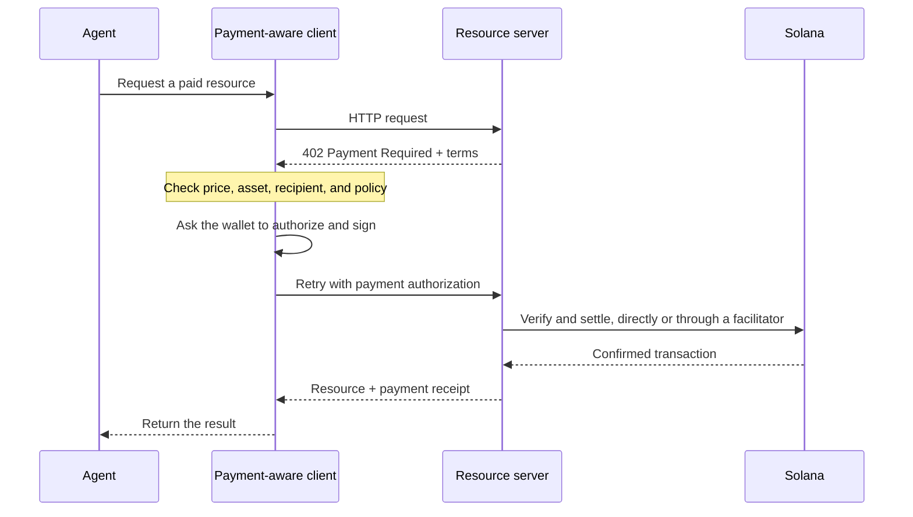

Thanh toán agentic cho phép phần mềm tìm hiểu mức giá, ủy quyền thanh toán và nhận
tài nguyên ngay trong cùng một quy trình HTTP. Một agent có thể trả phí cho một truy vấn dữ liệu, suy luận mô hình
hoặc lệnh gọi công cụ mà không cần tạo tài khoản thanh toán hay sao chép
khóa API trước.

<Cards>
  <Card title="MPP" href="/docs/payments/agentic-payments/mpp">
    Sử dụng xác thực HTTP cho các khoản thanh toán một lần và các phiên thanh toán theo mức sử dụng.
  </Card>
  <Card title="x402" href="/docs/payments/agentic-payments/x402">
    Thêm yêu cầu thanh toán, chữ ký và quy trình thanh toán x402 V2 vào một tài nguyên
    HTTP.
  </Card>
</Cards>

## Quy trình thanh toán chung

MPP và x402 sử dụng các header và mô hình dữ liệu khác nhau, nhưng quy trình HTTP cơ bản của chúng
khá giống nhau:

## MPP và x402

Cả hai giao thức đều có thể thanh toán bằng stablecoin trên Solana. Hãy lựa chọn dựa trên
mô hình thanh toán và khả năng tương tác mà dịch vụ của bạn cần, chứ không chỉ dựa vào mã trạng thái `402`
mà hai giao thức cùng dùng.

|                         | MPP                                                               | x402                                                                     |
| ----------------------- | ----------------------------------------------------------------- | ------------------------------------------------------------------------ |
| Thử thách (Challenge)               | `WWW-Authenticate: Payment`                                       | `PAYMENT-REQUIRED`                                                       |
| Ủy quyền từ client    | `Authorization: Payment`                                          | `PAYMENT-SIGNATURE`                                                      |
| Biên nhận                 | `Payment-Receipt`                                                 | `PAYMENT-RESPONSE`                                                       |
| Mô hình thanh toán trên Solana   | Intent `charge` (thanh toán một lần) và `session` (theo mức sử dụng, có giới hạn trần)           | Các scheme như `exact` và `upto`; mức hỗ trợ khác nhau tùy theo mạng và client |
| Kiến trúc thanh toán | Xác thực phía máy chủ, hoặc relay hay gateway tùy chọn                | Máy chủ tài nguyên xác minh cục bộ hoặc dùng facilitator                 |
| Điểm khởi đầu phù hợp     | Các API cần ngữ nghĩa xác thực HTTP hoặc đo lường mức sử dụng lặp lại | Các tài nguyên trả phí theo từng yêu cầu và các client x402 hiện có                      |

MPP là **Machine Payments Protocol**. Đừng nhầm lẫn với **Model
Context Protocol (MCP)**. MCP cung cấp các công cụ và tài nguyên cho agent; MPP hoặc x402
có thể yêu cầu thanh toán khi agent gọi một trong các công cụ đó.

<Callout type="info">
  Một dịch vụ có thể công bố nhiều hơn một giao thức. Client sẽ chọn một phương án thanh toán
  mà mình hỗ trợ, sau đó sử dụng các header challenge, authorization và
  receipt tương ứng trong suốt quá trình trao đổi.
</Callout>
