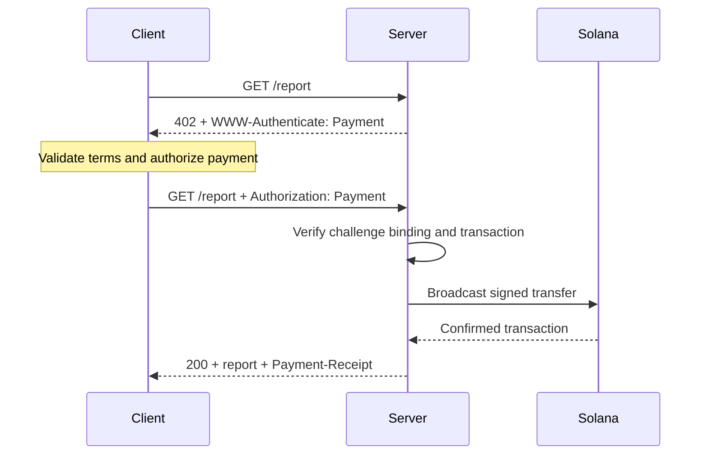
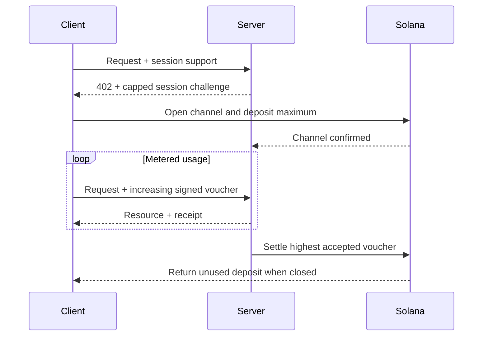

[Machine Payments Protocol (MPP)](https://mpp.dev/) áp dụng ngữ nghĩa xác thực HTTP cho thanh toán. Máy chủ gửi một thử thách (challenge) cho yêu cầu chưa thanh toán, máy khách trả về thông tin xác thực thanh toán, và máy chủ gửi lại biên nhận sau khi chấp nhận khoản thanh toán.

MPP tách biệt ba mối quan tâm:

- Một **intent** (ý định) mô tả tương tác thương mại, chẳng hạn như một lần
  `charge` hoặc một `session` tính phí theo mức sử dụng.
- Một **payment method** (phương thức thanh toán) mô tả cách giá trị được di chuyển. Phương thức Solana hỗ trợ
  SOL gốc và các token SPL cho các khoản charge.
- Một **transport** HTTP (lớp truyền tải) mang theo các challenge, credential, receipt và lỗi.

MPP được công bố dưới dạng một tập hợp các Internet-Draft. Hãy coi
[các đặc tả hiện hành](https://paymentauth.org/) là nguồn tham chiếu chính xác nhất và
lưu ý rằng các chi tiết có thể thay đổi khi các bản nháp vẫn đang được hoàn thiện.

## Trao đổi HTTP

MPP sử dụng các trường xác thực HTTP tiêu chuẩn thay vì các header
thanh toán riêng của giao thức:

| Thông điệp                 | Biểu diễn HTTP                                         |
| ----------------------- | ----------------------------------------------------------- |
| Thử thách thanh toán       | `402 Payment Required` với `WWW-Authenticate: Payment ...` |
| Thông tin xác thực thanh toán      | Yêu cầu được gửi lại với `Authorization: Payment ...`           |
| Biên nhận thành công      | Phản hồi tài nguyên với `Payment-Receipt: ...`               |
| Chi tiết thanh toán không hợp lệ | Nội dung Problem Details sử dụng `application/problem+json`       |



Một challenge bao gồm ID do máy chủ tạo, realm, method, intent, yêu cầu thanh toán đã mã hóa và thời hạn hết hiệu lực. Credential lặp lại challenge và bổ sung bằng chứng thanh toán riêng của từng method. Máy chủ phải xác minh cả hai thành phần; một giao dịch chuyển hợp lệ thuộc về challenge khác không được phép mở khóa tài nguyên.

## Các khoản charge một lần trên Solana

Intent `charge` của Solana hỗ trợ hai loại credential:

- **Chế độ Pull** sử dụng một giao dịch đã ký. Máy khách ký giao dịch chuyển và
  gửi giao dịch đó đến máy chủ. Máy chủ xác minh, có thể thêm chữ ký của
  fee-payer, phát sóng, xác nhận và trả về chữ ký giao dịch trong biên nhận.
- **Chế độ Push** sử dụng chữ ký giao dịch. Máy khách phát sóng trước, sau đó
  gửi chữ ký đã được xác nhận đến máy chủ. Máy chủ truy xuất và xác minh
  giao dịch trước khi trả về tài nguyên.

Chế độ Pull cho phép máy chủ tài trợ phí giao dịch và xử lý logic thử lại phía máy chủ.
Chế độ Push hữu ích khi ví yêu cầu máy khách tự gửi giao dịch của mình,
nhưng không thể sử dụng tính năng máy chủ tài trợ phí.

Để xem các trường quy chuẩn và quy tắc xác minh, hãy tham khảo
[đặc tả charge của Solana](https://paymentauth.org/draft-solana-charge-00.html).

## Thêm một khoản charge MPP vào Express API

Solana Pay Kit cung cấp một tích hợp TypeScript hiện hành cho MPP và x402.
Hãy cài đặt nó cùng với Express:

```bash
pnpm add @solana/pay-kit @solana/kit@^6.9.0 express
pnpm add --save-dev @types/express tsx
```

Ví dụ nhỏ nhất này sử dụng sandbox Surfpool được lưu trữ sẵn và người nhận demo công khai của gói. Ví dụ này chỉ dành cho phát triển cục bộ:

```ts filename=server.ts
import express from "express";
import { createPayKit, usd } from "@solana/pay-kit";

const pay = await createPayKit({
  accept: ["mpp"],
  rpcUrl: "https://402.surfnet.dev:8899"
});

const app = express();

app.get("/report", pay.express(usd("0.01")), (_req, res) => {
  res.json({ report: "Paid report" });
});

app.listen(4567, () => {
  console.log("Paid API listening on http://127.0.0.1:4567");
});
```

Chạy nó và so sánh một yêu cầu chưa thanh toán với một yêu cầu có hỗ trợ thanh toán:

```bash
pnpm tsx server.ts
curl -i http://127.0.0.1:4567/report
pay --sandbox curl http://127.0.0.1:4567/report
```

Trình xử lý route chỉ chạy sau khi middleware chấp nhận khoản thanh toán.

<Callout type="warn" title="Thay thế mọi giá trị mặc định của sandbox trong môi trường production">
  Hãy cấu hình mạng rõ ràng, người nhận của merchant, RPC chuyên dụng, khóa bí mật ràng buộc challenge ổn định, signer production và kho lưu trữ chống phát lại bền vững. Tuyệt đối không
  định tuyến các khoản thanh toán thật đến signer demo của gói.
</Callout>

## Phiên thanh toán theo mức sử dụng

Hãy dùng `session` MPP của Solana khi máy khách sẽ thực hiện nhiều khoản thanh toán nhỏ, có liên quan với nhau.
Một session mở ra một kênh thanh toán onchain với khoản ký quỹ tối đa, sau đó sử dụng
các voucher đã ký lũy kế khi mức sử dụng tăng lên. Máy chủ có thể xác minh voucher
offchain và quyết toán số tiền cao nhất đã được chấp nhận sau đó.

Cách này hữu ích cho suy luận tính phí theo token, tải xuống tính phí theo byte, dữ liệu trực tiếp
và các lệnh gọi công cụ lặp lại. Nó không giống với việc gửi một khoản thanh toán
onchain riêng cho từng sự kiện.



Hãy gọi session là **thanh toán theo phiên**, **kênh thanh toán** hoặc **ủy quyền lặp lại có giới hạn**. Chỉ gọi là thanh toán theo luồng (streamed payment) khi dịch vụ và hợp đồng thanh toán thực sự đo lường một luồng mức sử dụng.

## Xác minh trong môi trường production

Với mọi khoản charge trên Solana, máy chủ phải xác minh tối thiểu:

- Challenge là xác thực, chưa hết hạn, được ràng buộc với yêu cầu này và dành cho
  realm này.
- Giao dịch sử dụng đúng mạng, tài sản hoặc mint, người nhận, số tiền
  và token program như mong đợi.
- Mọi chỉ thị fee-payer hoặc associated token account đều được cho phép
  một cách tường minh và không thể làm cạn kiệt signer của máy chủ.
- Giao dịch đã thành công ở mức commitment yêu cầu.
- Chữ ký giao dịch chưa từng được sử dụng.
- Thao tác kiểm tra phát lại và đánh dấu đã sử dụng là nguyên tử trên tất cả các phiên bản máy chủ.

Đối với session, hãy lưu trữ bền vững trạng thái kênh, số tiền lũy kế đã chấp nhận và
mốc quyết toán trong một kho dùng chung. Hãy ghi lại cách máy khách thu hồi số tiền chưa sử dụng
nếu máy chủ không khả dụng.

## Tài nguyên liên quan

- [Đặc tả MPP](https://paymentauth.org/)
- [Tài liệu giao thức MPP](https://mpp.dev/protocol)
- [Solana Pay Kit](https://github.com/solana-foundation/pay-kit)
- [Tổng quan về thanh toán tác nhân](/docs/payments/agentic-payments)
- [Sẵn sàng cho production](/docs/tools/production-readiness)
