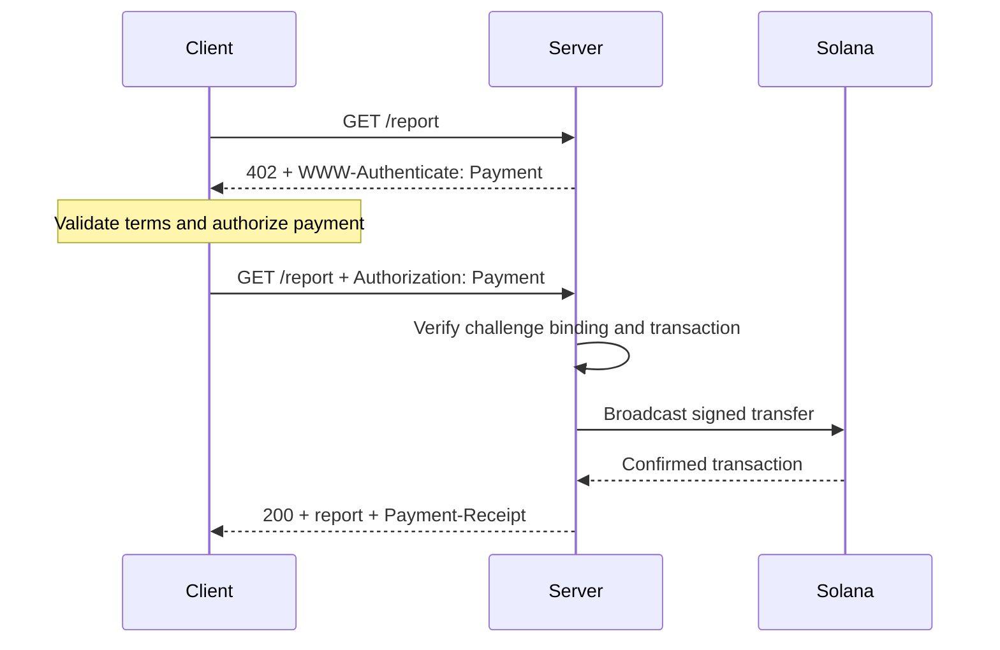
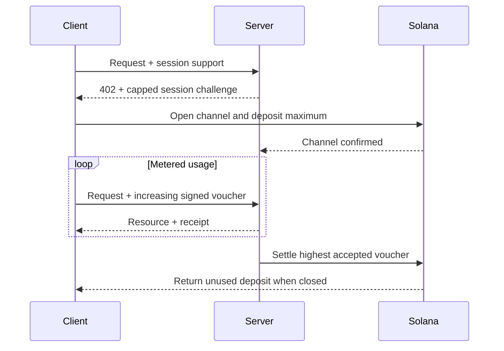

[Machine Payments Protocol (MPP)](https://mpp.dev/) áp dụng ngữ nghĩa xác thực HTTP cho thanh toán. Máy chủ gửi challenge cho một yêu cầu chưa thanh toán, client trả về credential thanh toán, và máy chủ trả về receipt sau khi
chấp nhận khoản thanh toán.

MPP tách biệt ba mối quan tâm:

- Một **intent** mô tả tương tác thương mại, chẳng hạn như một lần
  `charge` hoặc một `session` tính theo mức sử dụng.
- Một **payment method** (phương thức thanh toán) mô tả cách giá trị được chuyển đi. Phương thức Solana hỗ trợ
  SOL gốc và token SPL cho các khoản charge.
- Một **transport** HTTP mang challenge, credential, receipt và lỗi.

MPP được công bố dưới dạng một tập các Internet-Draft. Hãy coi
[các đặc tả hiện hành](https://paymentauth.org/) là nguồn tham chiếu chuẩn và
dự kiến các chi tiết sẽ thay đổi trong khi các bản draft vẫn đang được hoàn thiện.

## Trao đổi HTTP

MPP sử dụng các trường xác thực HTTP tiêu chuẩn thay vì các header
thanh toán riêng của giao thức:

| Thông điệp                 | Biểu diễn HTTP                                         |
| ----------------------- | ----------------------------------------------------------- |
| Challenge thanh toán       | `402 Payment Required` với `WWW-Authenticate: Payment ...` |
| Credential thanh toán      | Yêu cầu được gửi lại với `Authorization: Payment ...`           |
| Receipt thành công      | Phản hồi tài nguyên với `Payment-Receipt: ...`               |
| Chi tiết thanh toán không hợp lệ | Phần thân Problem Details sử dụng `application/problem+json`       |



Một challenge bao gồm ID do máy chủ tạo, realm, method, intent, payment request đã mã hóa
và thời hạn. Credential lặp lại challenge và bổ sung
bằng chứng thanh toán riêng theo từng method. Máy chủ phải xác minh cả hai phần; một giao dịch
chuyển hợp lệ thuộc về challenge khác không được mở khóa tài nguyên.

## Các khoản charge một lần trên Solana

Intent `charge` của Solana hỗ trợ hai loại credential:

- **Chế độ pull** dùng một giao dịch đã ký. Client ký giao dịch chuyển và
  gửi giao dịch đó đến máy chủ. Máy chủ xác minh, có thể thêm chữ ký
  fee-payer, broadcast, xác nhận, rồi trả về chữ ký giao dịch
  trong receipt.
- **Chế độ push** dùng một chữ ký giao dịch. Client broadcast trước, sau đó
  gửi chữ ký đã được xác nhận đến máy chủ. Máy chủ truy xuất và xác minh
  giao dịch trước khi trả về tài nguyên.

Chế độ pull cho phép máy chủ tài trợ phí giao dịch và có logic thử lại phía máy chủ.
Chế độ push hữu ích khi ví yêu cầu client tự gửi
giao dịch của mình, nhưng không thể dùng tính năng máy chủ tài trợ phí.

Về các trường chuẩn tắc và quy tắc xác minh, xem
[đặc tả Solana charge](https://paymentauth.org/draft-solana-charge-00.html).

## Thêm một khoản MPP charge vào API Express

Solana Pay Kit cung cấp một tích hợp TypeScript hiện hành cho MPP và x402.
Cài đặt cùng với Express:

```bash
pnpm add @solana/pay-kit @solana/kit@^6.9.0 express
pnpm add --save-dev @types/express tsx
```

Ví dụ nhỏ nhất này dùng sandbox Surfpool được lưu trữ và người nhận demo công khai
của gói. Chỉ dùng cho phát triển cục bộ:

```ts filename=server.ts
import express from "express";
import { createPayKit, usd } from "@solana/pay-kit";

const pay = await createPayKit({
  accept: ["mpp"],
  rpcUrl: "https://402.surfnet.dev:8899"
});

const app = express();

app.get("/report", pay.express(usd("0.01")), (_req, res) => {
  res.json({ report: "Paid report" });
});

app.listen(4567, () => {
  console.log("Paid API listening on http://127.0.0.1:4567");
});
```

Chạy nó và so sánh một yêu cầu chưa thanh toán với một yêu cầu có nhận biết thanh toán:

```bash
pnpm tsx server.ts
curl -i http://127.0.0.1:4567/report
pay --sandbox curl http://127.0.0.1:4567/report
```

Route handler chỉ chạy sau khi middleware chấp nhận khoản thanh toán.

<Callout type="warn" title="Thay thế mọi giá trị mặc định của sandbox trong môi trường production">
  Hãy cấu hình mạng tường minh, người nhận của merchant, RPC chuyên dụng, secret
  gắn challenge ổn định, signer production và replay store bền vững. Tuyệt đối không
  định tuyến thanh toán thật đến signer demo của gói.
</Callout>

## Các phiên tính theo mức sử dụng

Hãy dùng `session` MPP của Solana khi client sẽ thực hiện nhiều khoản thanh toán nhỏ, có liên quan với nhau.
Một session mở một kênh thanh toán onchain với mức ký quỹ tối đa, sau đó dùng
các voucher đã ký tích lũy khi mức sử dụng tăng lên. Máy chủ có thể xác minh voucher
offchain và quyết toán số tiền cao nhất đã được chấp nhận vào một thời điểm sau.

Cách này hữu ích cho suy luận (inference) tính theo token, tải xuống tính theo byte, dữ liệu trực tiếp
và các lệnh gọi công cụ lặp lại. Nó không giống với việc gửi một khoản thanh toán
onchain riêng cho mỗi sự kiện.



Hãy gọi session là **thanh toán theo phiên**, **kênh thanh toán** hoặc **ủy quyền lặp lại có giới hạn**. Chỉ gọi là thanh toán dạng luồng (streaming) khi dịch vụ và hợp đồng thanh toán thực sự tính phí theo một luồng mức sử dụng.

## Xác minh trong môi trường production

Với mọi khoản Solana charge, máy chủ ít nhất phải xác minh:

- Challenge là xác thực, chưa hết hạn, được gắn với yêu cầu này và dành cho
  realm này.
- Giao dịch dùng đúng mạng, tài sản hoặc mint, người nhận, số tiền
  và token program như kỳ vọng.
- Mọi instruction fee-payer hoặc associated-token-account đều được cho phép
  một cách tường minh và không thể rút cạn signer của máy chủ.
- Giao dịch thành công ở mức commitment yêu cầu.
- Chữ ký giao dịch chưa bị sử dụng trước đó.
- Việc kiểm tra replay và thao tác consume là nguyên tử trên mọi instance máy chủ.

Với các session, hãy lưu trữ bền vững trạng thái kênh, số tiền tích lũy đã chấp nhận và
watermark quyết toán trong một kho dùng chung. Hãy ghi lại cách client thu hồi số
tiền chưa dùng nếu máy chủ không khả dụng.

## Tài nguyên liên quan

- [Đặc tả MPP](https://paymentauth.org/)
- [Tài liệu giao thức MPP](https://mpp.dev/protocol)
- [Solana Pay Kit](https://github.com/solana-foundation/pay-kit)
- [Tổng quan về thanh toán agentic](/docs/payments/agentic-payments)
- [Mức độ sẵn sàng cho production](/docs/tools/security#verify-addresses)
