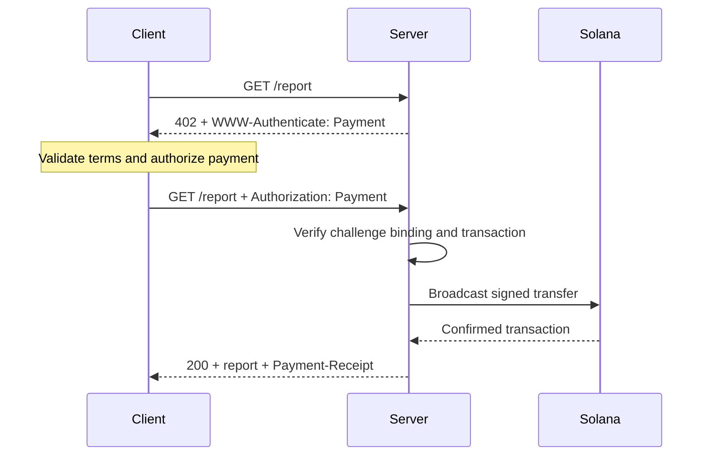
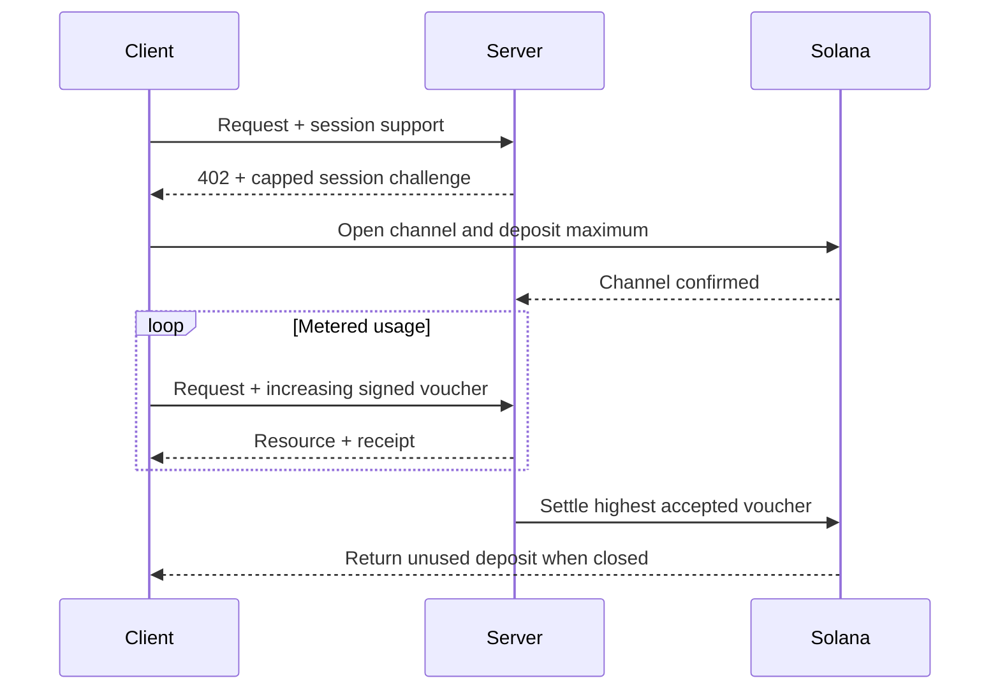

[Machine Payments Protocol (MPP)](https://mpp.dev/) áp dụng ngữ nghĩa xác thực HTTP cho thanh toán. Máy chủ gửi thử thách đối với một yêu cầu chưa thanh toán, máy khách trả về thông tin xác thực thanh toán, và máy chủ trả về biên nhận sau khi chấp nhận khoản thanh toán.

MPP tách biệt ba mối quan tâm:

- Một **intent** (ý định) mô tả tương tác thương mại, chẳng hạn như một lần
  `charge` hoặc một `session` tính phí theo mức sử dụng.
- Một **phương thức thanh toán** mô tả cách giá trị được chuyển đi. Phương thức Solana hỗ trợ
  SOL gốc và các token SPL cho các khoản charge.
- Một **transport** HTTP mang các thử thách, thông tin xác thực, biên nhận và lỗi.

MPP được công bố dưới dạng một tập hợp các Internet-Draft. Hãy coi
[các đặc tả hiện hành](https://paymentauth.org/) là nguồn tham chiếu chuẩn và
lưu ý rằng các chi tiết có thể thay đổi khi các bản nháp vẫn đang được hoàn thiện.

## Trao đổi HTTP

MPP sử dụng các trường xác thực HTTP tiêu chuẩn thay vì các header
thanh toán dành riêng cho giao thức:

| Thông điệp                 | Biểu diễn HTTP                                         |
| ----------------------- | ----------------------------------------------------------- |
| Thử thách thanh toán       | `402 Payment Required` với `WWW-Authenticate: Payment ...` |
| Thông tin xác thực thanh toán      | Yêu cầu được gửi lại với `Authorization: Payment ...`           |
| Biên nhận thành công      | Phản hồi tài nguyên với `Payment-Receipt: ...`               |
| Chi tiết thanh toán không hợp lệ | Nội dung Problem Details sử dụng `application/problem+json`       |



Một thử thách bao gồm ID do máy chủ tạo, realm, phương thức, intent, yêu cầu
thanh toán đã mã hóa và thời hạn. Thông tin xác thực lặp lại thử thách và bổ sung
bằng chứng thanh toán dành riêng cho phương thức. Máy chủ phải xác minh cả hai phần; một
giao dịch chuyển hợp lệ thuộc về một thử thách khác không được phép mở khóa tài nguyên.

## Các khoản charge một lần trên Solana

Intent `charge` của Solana hỗ trợ hai loại thông tin xác thực:

- **Chế độ pull** sử dụng giao dịch đã ký. Máy khách ký giao dịch chuyển và
  gửi giao dịch đó đến máy chủ. Máy chủ xác minh, tùy chọn thêm chữ ký của
  người trả phí, phát sóng, xác nhận và trả về chữ ký giao dịch trong
  biên nhận.
- **Chế độ push** sử dụng chữ ký giao dịch. Máy khách phát sóng trước, sau đó
  gửi chữ ký đã xác nhận đến máy chủ. Máy chủ truy xuất và xác minh
  giao dịch trước khi trả về tài nguyên.

Chế độ pull cho phép máy chủ tài trợ phí giao dịch và có logic thử lại phía máy chủ.
Chế độ push hữu ích khi ví yêu cầu máy khách tự gửi giao dịch của mình,
nhưng không thể sử dụng tính năng tài trợ phí từ máy chủ.

Để biết các trường quy chuẩn và quy tắc xác minh, hãy xem
[đặc tả charge của Solana](https://paymentauth.org/draft-solana-charge-00.html).

## Thêm một MPP charge vào Express API

Solana Pay Kit cung cấp một tích hợp TypeScript hiện hành cho MPP và x402.
Cài đặt nó cùng với Express:

```bash
pnpm add @solana/pay-kit @solana/kit@^6.9.0 express
pnpm add --save-dev @types/express tsx
```

Ví dụ nhỏ gọn nhất này sử dụng sandbox Surfpool được lưu trữ và người nhận
demo công khai của gói. Ví dụ chỉ dành cho phát triển cục bộ:

```ts filename=server.ts
import express from "express";
import { createPayKit, usd } from "@solana/pay-kit";

const pay = await createPayKit({
  accept: ["mpp"],
  rpcUrl: "https://402.surfnet.dev:8899"
});

const app = express();

app.get("/report", pay.express(usd("0.01")), (_req, res) => {
  res.json({ report: "Paid report" });
});

app.listen(4567, () => {
  console.log("Paid API listening on http://127.0.0.1:4567");
});
```

Chạy nó và so sánh một yêu cầu chưa thanh toán với một yêu cầu có hỗ trợ thanh toán:

```bash
pnpm tsx server.ts
curl -i http://127.0.0.1:4567/report
pay --sandbox curl http://127.0.0.1:4567/report
```

Trình xử lý route chỉ chạy sau khi middleware chấp nhận khoản thanh toán.

<Callout type="warn" title="Thay thế mọi giá trị mặc định của sandbox trong môi trường production">
  Hãy cấu hình mạng rõ ràng, người nhận của merchant, RPC chuyên dụng, khóa bí mật
  liên kết thử thách ổn định, trình ký production và kho lưu trữ chống phát lại bền vững. Tuyệt đối không
  định tuyến các khoản thanh toán thật đến trình ký demo của gói.
</Callout>

## Phiên tính phí theo mức sử dụng

Hãy dùng `session` MPP của Solana khi máy khách sẽ thực hiện nhiều khoản thanh toán nhỏ có liên quan với nhau.
Một session mở một kênh thanh toán onchain với mức ký quỹ tối đa, sau đó dùng
các voucher đã ký tích lũy khi mức sử dụng tăng lên. Máy chủ có thể xác minh voucher
offchain và quyết toán số tiền cao nhất đã được chấp nhận sau đó.

Cách này hữu ích cho suy luận tính phí theo token, tải xuống tính phí theo byte, dữ liệu trực tiếp
và các lệnh gọi công cụ lặp lại. Nó không giống với việc gửi một khoản thanh toán
onchain riêng cho từng sự kiện.



Hãy gọi session là **thanh toán theo phiên**, **kênh thanh toán** hoặc **ủy quyền lặp lại có giới hạn**.
Chỉ gọi là thanh toán dạng luồng khi dịch vụ và hợp đồng thanh toán
thực sự đo lường một luồng mức sử dụng.

## Xác minh trong môi trường production

Với mọi khoản charge trên Solana, máy chủ tối thiểu phải xác minh:

- Thử thách là xác thực, chưa hết hạn, được ràng buộc với yêu cầu này và dành cho
  realm này.
- Giao dịch sử dụng đúng mạng, tài sản hoặc mint, người nhận, số tiền
  và token program như mong đợi.
- Mọi chỉ thị về người trả phí hoặc associated token account đều được
  cho phép một cách tường minh và không thể rút cạn trình ký của máy chủ.
- Giao dịch đã thành công ở mức commitment yêu cầu.
- Chữ ký giao dịch chưa được sử dụng trước đó.
- Thao tác kiểm tra phát lại và tiêu thụ là nguyên tử trên tất cả các phiên bản máy chủ.

Với các session, cũng cần lưu trữ trạng thái kênh, số tiền tích lũy đã chấp nhận và
mốc quyết toán trong một kho dùng chung. Hãy lập tài liệu về cách máy khách thu hồi số
tiền chưa dùng nếu máy chủ không khả dụng.

## Tài nguyên liên quan

- [Đặc tả MPP](https://paymentauth.org/)
- [Tài liệu giao thức MPP](https://mpp.dev/protocol)
- [Solana Pay Kit](https://github.com/solana-foundation/pay-kit)
- [Tổng quan về thanh toán tác nhân](/docs/payments/agentic-payments)
- [Mức độ sẵn sàng cho production](/docs/tools/security#verify-addresses)
