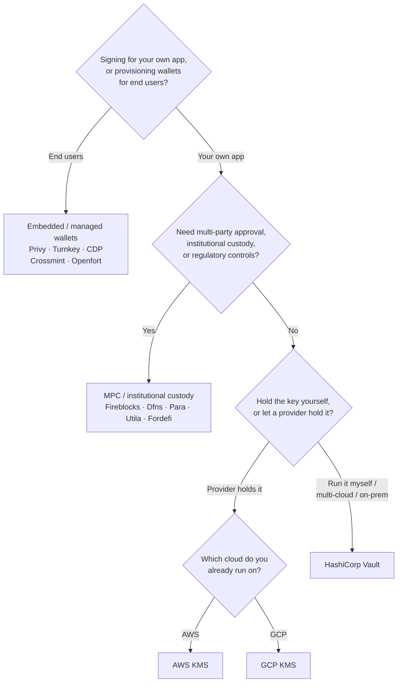

Keychain cung cấp một giao diện cơ sở `SolanaSigner` thống nhất trên mọi backend, vì
vậy với hầu hết các backend, việc lựa chọn mang tính vận hành, không phải kiến trúc: bạn có thể thay đổi
sau thông qua cấu hình. Ngoại lệ là hình thức của giao dịch. Chế độ auto native của Crossmint
và Fordefi ký và broadcast ở phía server, còn chế độ manual native của Fordefi
viết lại giao dịch trước khi ký, nên việc chuyển sang hoặc từ một trong số
chúng sẽ thay đổi cách bạn gọi signer. Vì lý do đó, **hãy bắt đầu từ yêu cầu của bạn,
không phải từ một sản phẩm.** Hai câu hỏi quyết định phần lớn: _khóa riêng tư được lưu
ở đâu, và ai được phép ủy quyền chữ ký với nó?_

Mọi backend ngoại trừ Ledger đều có sẵn trong cả bốn ngôn ngữ (Rust, TypeScript,
Python và Go). Ledger chỉ hỗ trợ Rust, nằm sau tính năng `ledger` tùy chọn bật thêm.

Không có backend nào là tốt nhất cho mọi trường hợp. Mỗi backend phù hợp hơn với một tập
ràng buộc cụ thể: đám mây bạn đang chạy, việc bạn có muốn tự vận hành hạ tầng khóa hay không,
và các kiểm soát về lưu ký và phê duyệt mà bạn bắt buộc phải có.
Lưu đồ bên dưới ánh xạ các ràng buộc đó tới một backend.

<Callout type="info">
  Hướng dẫn này đề cập đến việc ký ở phía backend (server). Khi người dùng cuối ký
  giao dịch của chính họ trong trình duyệt, hãy dùng ví thông qua Wallet Standard
  thay thế. Xem [Ký trong môi trường
  Production](/docs/core/transactions/signing-in-production).
</Callout>

## Luồng quyết định

<Callout type="info">
  Phát triển cục bộ và kiểm thử không cần đến những điều này: hãy dùng backend **Memory**
  để làm nguyên mẫu, sau đó chuyển sang một trong các backend production ở trên thông qua
  cấu hình.
</Callout>

## Đi qua từng câu hỏi

<Steps>

<Step>

### Bạn đang ký cho ứng dụng của chính mình hay cho người dùng cuối?

Nếu bạn cấp ví mà **người dùng cuối** sở hữu và vận hành (ứng dụng tiêu dùng,
quy trình onboarding), hãy dùng backend **ví nhúng / ví được quản lý**: Privy, Turnkey,
CDP, Crossmint hoặc Openfort. Các backend này quản lý ví và xác thực cho từng người dùng thay
bạn.

Nếu bạn ký với tư cách **ứng dụng của chính mình** (người trả phí, kho quỹ, tự động hóa
backend), hãy tiếp tục bên dưới.

</Step>

<Step>

### Bạn có cần phê duyệt đa bên, lưu ký tổ chức hoặc kiểm soát tuân thủ quy định không?

Nếu chữ ký phải vượt qua chính sách phê duyệt, hạn mức chi tiêu hoặc quy trình tuân thủ
trước khi được tạo ra, hoặc bạn cần một đơn vị lưu ký được quản lý nắm giữ
khóa, hãy dùng backend **MPC / lưu ký tổ chức**: Fireblocks, Dfns, Para,
Utila hoặc Fordefi. Các backend này chia nhỏ hoặc lưu ký khóa và đồng ký theo
chính sách của bạn.

Nếu bạn chỉ cần một khóa ký theo yêu cầu, hãy tiếp tục bên dưới.

</Step>

<Step>

### Bạn muốn tự nắm giữ khóa hay để nhà cung cấp nắm giữ?

Nếu nhà cung cấp đám mây nên nắm giữ khóa trong hạ tầng được hỗ trợ bằng phần cứng và
chính sách IAM của bạn kiểm soát ai có thể ký, hãy dùng KMS của đám mây đó:

- **Chạy trên AWS** → AWS KMS
- **Chạy trên GCP** → GCP KMS

Nếu bạn muốn tự vận hành hạ tầng khóa, hoặc bạn dùng đa đám mây hoặc
on-prem, hãy dùng **HashiCorp Vault**. Bạn tự vận hành và kiểm toán nó; khóa nằm trong
Transit engine và ký theo yêu cầu.

</Step>

</Steps>

## Các mô hình lưu ký

Các backend được chia thành sáu mô hình lưu ký. Lưu đồ ở trên sẽ đưa bạn đến một trong số
chúng.

- **Tự lưu ký (trong tiến trình)**: ứng dụng của bạn nắm giữ khóa riêng tư thô.
  Tiện lợi cho phát triển nhưng không phù hợp cho production. Backend:
  **Memory**.
- **Tự lưu ký (ví phần cứng)**: khóa không bao giờ rời thiết bị Ledger, và
  một người xác nhận mọi chữ ký trên màn hình của thiết bị. Phù hợp để người vận hành
  ký tương tác, không phù hợp cho các dịch vụ chạy không giám sát. Chỉ hỗ trợ Rust, tùy chọn bật thêm và không nằm trong phạm vi
  kiểm toán. Backend: **Ledger**.
- **Quản lý khóa tự lưu trữ**: bạn vận hành hạ tầng khóa; khóa
  nằm trong đó và ký theo yêu cầu. Backend: **HashiCorp Vault**.
- **Cloud KMS / HSM**: nhà cung cấp đám mây lưu khóa trong hạ tầng được hỗ trợ
  bằng phần cứng; khóa không bao giờ rời khỏi dịch vụ và chính sách IAM của bạn kiểm soát
  ai có thể ký. Backend: **AWS KMS**, **GCP KMS**.
- **MPC và lưu ký tổ chức**: khóa được chia nhỏ hoặc lưu ký tại một
  nhà cung cấp, nhà cung cấp này đồng ký theo chính sách của bạn (phê duyệt, hạn mức).
  Backend: **Fireblocks**, **Dfns**, **Para**, **Utila**, **Fordefi**.
- **Ví nhúng và ví được quản lý**: nhà cung cấp quản lý ví thay bạn,
  thường để onboarding người dùng cuối. Backend: **Privy**, **Turnkey**, **CDP**,
  **Crossmint**, **Openfort**.

## So sánh Backend

| Backend         | Mô hình lưu ký                  | Phù hợp nhất cho                                     | Ghi chú                                                                                                              |
| --------------- | ------------------------------ | -------------------------------------------- | ------------------------------------------------------------------------------------------------------------------ |
| Memory          | Tự lưu ký (trong tiến trình)      | Phát triển cục bộ, kiểm thử, CI                 | Khóa thô nằm trong tiến trình; không dùng trong production                                                                       |
| Ledger          | Tự lưu ký (ví phần cứng) | Người vận hành ký tương tác từ các công cụ Rust | Chỉ hỗ trợ Rust, tính năng `ledger` tùy chọn bật thêm, chưa được kiểm toán; mọi chữ ký đều được xác nhận trên thiết bị                                 |
| HashiCorp Vault | Quản lý khóa tự lưu trữ     | Nhóm vận hành hạ tầng khóa riêng   | Transit engine; bạn tự vận hành và kiểm toán                                                                           |
| AWS KMS         | Cloud KMS / HSM                | Backend chạy trên AWS                      | Khóa không bao giờ rời khỏi KMS; IAM kiểm soát việc ký                                                                         |
| GCP KMS         | Cloud KMS / HSM                | Backend chạy trên GCP                      | Khóa không bao giờ rời khỏi KMS; IAM kiểm soát việc ký                                                                         |
| Fireblocks      | MPC / lưu ký tổ chức    | Quỹ, sàn giao dịch, lưu ký có kiểm soát     | Policy engine và quy trình phê duyệt                                                                               |
| Dfns            | Hạ tầng ví MPC      | Ví lập trình với kiểm soát chính sách    | Ký Ed25519                                                                                                    |
| Para            | Ví MPC                    | Ứng dụng muốn dùng ví được hỗ trợ bởi MPC            | API key + wallet ID                                                                                                |
| Utila           | MPC custody + đồng ký        | Ví Solana được quản lý bởi Utila        | `signMessage` không được hỗ trợ; bạn tự phát sóng tx                                                                    |
| Fordefi         | MPC / lưu ký tổ chức    | Lưu ký tổ chức với kiểm soát chính sách   | Hộp đen: bạn gửi. Native auto: Fordefi viết lại và gửi. Native manual: Fordefi viết lại, bạn gửi kết quả |
| Privy           | Ví nhúng               | Ứng dụng tiêu dùng onboarding người dùng vào ví    | Ví nhúng do ứng dụng quản lý                                                                                       |
| Turnkey         | Quản lý khóa phi lưu ký   | Ký lập trình có kiểm soát chính sách           | Quản lý khóa phi lưu ký                                                                                       |
| CDP             | Ví được quản lý (Coinbase)      | Ứng dụng trên Coinbase Developer Platform      | `signMessage` chỉ nhận payload UTF-8                                                                          |
| Crossmint       | Ví được quản lý                | Marketplace và ứng dụng ví được quản lý         | Chỉ gửi: broadcast ở phía server, có thể viết lại để tài trợ gas; không hỗ trợ `signMessage`                   |
| Openfort        | Ví backend nhúng       | Ví phía server                          | Khóa lưu trữ trong TEE                                                                                                    |

## Hình thức khả năng

Ngoài quyền lưu ký, mỗi backend có một hình thức giao dịch, và hình thức này quyết định cách bạn
gọi signer:

- **Ký**: nhà cung cấp ký các byte bạn đã dựng và bạn broadcast chúng. Hầu hết các
  backend, bao gồm Ledger và chế độ hộp đen của Fordefi.
- **Viết lại và ký**: nhà cung cấp viết lại giao dịch, sau đó ký mà
  không broadcast. Hãy tiếp tục từ giao dịch được trả về. Chế độ manual native của Fordefi.
- **Ký và broadcast**: nhà cung cấp ký và broadcast ở phía server, nên khi
  có lỗi không có nghĩa là chưa có gì được ghi nhận. Crossmint và chế độ auto native của Fordefi.

Bảng khả năng của signer trong README của từng ngôn ngữ liệt kê hình thức của mọi
backend;
[mô hình bảo mật](https://github.com/solana-foundation/solana-keychain/blob/main/docs/SECURITY_MODEL.md)
giải thích mỗi hình thức đảm bảo điều gì.

## Các kịch bản doanh nghiệp

Một ứng dụng đơn lẻ thường cần nhiều hơn một trong số này cùng lúc. Vì giao diện
được dùng chung, bạn có thể chạy một backend khác nhau cho mỗi vai trò mà không cần thay đổi
nơi gọi, miễn là các backend có cùng hình thức khả năng.

- **Vận hành ngân quỹ** — tách biệt bộ ký "nóng" vận hành với bộ ký "lạnh" của
  ngân quỹ. Hỗ trợ ngân quỹ bằng lưu ký MPC hoặc HSM đám mây và yêu cầu chính
  sách phê duyệt trước khi thực hiện chữ ký có giá trị cao.
- **Quy trình phê duyệt** — các backend MPC và lưu ký (ví dụ: Fireblocks) thực
  thi phê duyệt đa bên trước khi tạo chữ ký.
- **Tuân thủ và kiểm toán** — KMS đám mây (AWS/GCP) và Vault phát sinh nhật ký
  kiểm toán ký; các tổ chức lưu ký thêm chức năng thực thi chính sách và báo
  cáo.
- **Môi trường được quản lý** — lưu trữ tài liệu khóa trong HSM, KMS hoặc tổ
  chức lưu ký để khóa thô không bao giờ tiếp xúc với ứng dụng của bạn.

Xem
[Các phương pháp hay nhất cho môi trường sản xuất](/docs/tools/keychain/production-best-practices)
để vận hành các backend này một cách an toàn.

<Cards>
  <Card title="Hướng dẫn Rust" href="/docs/tools/keychain/getting-started/rust">
    Cấu hình từng backend trong Rust.
  </Card>
  <Card
    title="Hướng dẫn TypeScript"
    href="/docs/tools/keychain/getting-started/typescript"
  >
    Cấu hình từng backend trong TypeScript.
  </Card>
</Cards>
