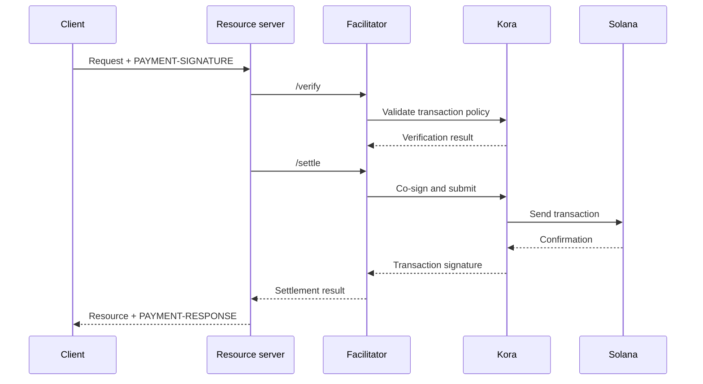

x402 facilitator thực hiện việc xác minh và quyết toán thanh toán cho một hoặc nhiều
máy chủ tài nguyên. Nhờ đó, API có thể chấp nhận thanh toán onchain mà không cần đưa logic RPC,
gửi giao dịch và trả phí giao dịch vào từng tiến trình ứng dụng.

Facilitator là một vai trò về mặt kiến trúc, không nhất thiết phải là bên thứ ba. Bạn có thể dùng
dịch vụ được quản lý, vận hành một facilitator riêng biệt, hoặc tự đảm nhiệm vai trò facilitator ngay trong
máy chủ tài nguyên của mình.

## Giao diện của facilitator

x402 V2 định nghĩa ba thao tác HTTP:

| Endpoint     | Mục đích                                                                       |
| ------------ | ----------------------------------------------------------------------------- |
| `/supported` | Liệt kê các phiên bản giao thức, scheme, mạng, tiện ích mở rộng và signer được hỗ trợ |
| `/verify`    | Kiểm tra payload thanh toán theo các yêu cầu của nó mà không quyết toán         |
| `/settle`    | Gửi hoặc hoàn tất thanh toán và trả về kết quả quyết toán            |

Máy chủ tài nguyên của bạn nên kiểm tra `/supported` khi khởi động hoặc triển khai. Đừng
quảng bá một tùy chọn thanh toán cho đến khi facilitator được chọn xác nhận hỗ trợ
chính xác phiên bản x402, scheme và mạng Solana đó.

```bash
curl https://facilitator.example/supported
```

## Xác minh trước khi thực hiện yêu cầu

Thứ tự xử lý yêu cầu an toàn như sau:

1. Phân tích payload `PAYMENT-SIGNATURE` bằng thư viện giao thức.
2. Đối chiếu với đúng `PaymentRequirements` đã được đưa ra ban đầu.
3. Xác minh payload ở phía cục bộ hoặc thông qua `/verify`.
4. Chỉ thực hiện thao tác tài nguyên nếu luồng thanh toán đã chọn cho phép
   quyết toán sau khi hoàn tất yêu cầu.
5. Gọi `/settle` và trả về `PAYMENT-RESPONSE` kèm kết quả.

Mỗi scheme có thể định nghĩa thứ tự thực hiện yêu cầu khác nhau. Ví dụ, một
luồng ủy quyền có thể xác minh trước thao tác tài nguyên và quyết toán sau đó,
trong khi scheme khác có thể yêu cầu quyết toán trước khi thực hiện yêu cầu. Hãy làm theo luồng
được scheme đã chọn khai báo thay vì mặc định áp dụng một thứ tự cho mọi
thanh toán.

<Callout type="warn" title="Hãy coi phản hồi của facilitator là các quyết định thanh toán">
  Hãy xác thực lưu lượng của facilitator, kiểm tra mọi phản hồi, đặt thời gian chờ
  nghiêm ngặt và áp dụng nguyên tắc từ chối khi lỗi (fail closed). Lỗi mạng hoặc phản hồi sai định dạng không phải là bằng chứng
  của việc thanh toán.
</Callout>

## Chọn mô hình triển khai

| Mô hình                   | Khi nào nên dùng                                                        | Trách nhiệm chính                                                    |
| ----------------------- | --------------------------------------------------------------- | ---------------------------------------------------------------------- |
| Facilitator được quản lý     | Bạn muốn phạm vi vận hành nhỏ nhất                       | Xem xét các mạng được hỗ trợ, mô hình tin cậy, tính sẵn sàng và chính sách dữ liệu  |
| Tự lưu trữ chuyên dụng   | Nhiều API dùng chung hạ tầng ký và quyết toán        | Bảo mật khóa, RPC, lưu trữ, mở rộng quy mô và nâng cấp                      |
| Facilitator chạy trong cùng tiến trình | Một dịch vụ cần toàn quyền kiểm soát và có thể vận hành các thành phần chuỗi | Giữ mã thanh toán được cô lập và ngăn tải yêu cầu làm cạn kiệt tài nguyên của nó |

Đừng chọn một facilitator chỉ vì URL của nó phản hồi `/supported`.
Hãy xem xét cách nó bảo vệ khóa của tài khoản trả phí, ngăn chặn replay, xác nhận giao dịch,
xử lý lỗi một phần và báo cáo sự cố.

## Kora làm hạ tầng ký giao dịch Solana

[Kora](/docs/tools/kora) là một node signer của Solana với các chính sách xác thực giao dịch và
tài trợ phí. x402 facilitator có thể dùng Kora làm backend ký và
gửi giao dịch:



Kora không thay thế x402. Máy chủ tài nguyên và facilitator vẫn triển khai
các đối tượng và endpoint của x402 V2; Kora thực thi chính sách giao dịch Solana và
bảo vệ signer của tài khoản trả phí đằng sau giao diện RPC của nó.

Hãy làm theo [hướng dẫn Kora x402](/docs/tools/kora/guides/x402) để xem
bản demo và cấu hình được duy trì.

## Danh sách kiểm tra cho môi trường production

### Khóa và chính sách giao dịch

- Lưu khóa của facilitator và tài khoản trả phí trong backend ký từ xa hoặc được hỗ trợ bởi
  phần cứng.
- Chỉ đưa vào danh sách cho phép các chương trình System, Compute Budget, Token, Token-2022 và Associated Token
  khi scheme được hỗ trợ yêu cầu.
- Từ chối các tài khoản có thể ghi, authority chuyển khoản, người nhận, mint,
  instruction và giá compute không mong muốn trước khi ký.
- Giữ các tài khoản nhận thanh toán tách biệt với các tài khoản trả phí phục vụ vận hành.

### Replay và tính idempotent

- Lưu trữ các mã định danh thanh toán đã dùng và chữ ký giao dịch trong một kho dữ liệu
  dùng chung, bền vững.
- Đảm bảo việc xác minh và tiêu thụ là nguyên tử để hai phiên bản máy chủ không thể chấp nhận
  cùng một ủy quyền đồng thời.
- Yêu cầu khóa idempotency cho các thao tác tài nguyên có tác dụng phụ.
- Trả về kết quả ban đầu cho lần thử lại hợp lệ thay vì tính phí lần nữa.

### Tính sẵn sàng và xử lý lỗi

- Đặt thời gian chờ có giới hạn cho `/verify`, `/settle`, việc gửi qua RPC và
  xác nhận.
- Phân biệt các quyết toán bị từ chối, hết hạn, đang chờ, đã xác nhận và thất bại.
- Không dựng lại hoặc ký lại giao dịch sau khi blockhash hết hạn mà chưa yêu cầu
  người thanh toán ủy quyền cho giao dịch mới.
- Sử dụng nhiều hơn một endpoint RPC và theo dõi độ mới của blockhash, độ trễ
  xác nhận và số dư của tài khoản trả phí.

### Khả năng quan sát

Ghi lại tài nguyên, challenge ID, scheme và mạng đã chọn, số tiền, tài sản,
người nhận, địa chỉ người thanh toán, chữ ký giao dịch, mức xác nhận, độ trễ
và trạng thái cuối cùng. Tuyệt đối không ghi log thông tin xác thực thanh toán đã mã hóa, bearer token, khóa
riêng tư hoặc phản hồi thô của signer.

Đặt cảnh báo cho các lỗi quyết toán, nỗ lực replay, các từ chối theo chính sách, tài sản
hoặc người nhận bất thường, tình trạng cạn tiền của tài khoản trả phí, và chênh lệch giữa các khoản
thanh toán đã xác minh và tài nguyên đã được cung cấp.

## Tài nguyên liên quan

- [Đặc tả x402 facilitator](https://github.com/x402-foundation/x402/blob/main/specs/x402-specification-v2.md#7-facilitator-interface)
- [x402 trên Solana](/docs/payments/agentic-payments/x402)
- [Hướng dẫn vận hành Kora](/docs/tools/kora/operators)
- [Sẵn sàng cho môi trường production](/docs/tools/transaction-landing#rpc-infrastructure)
