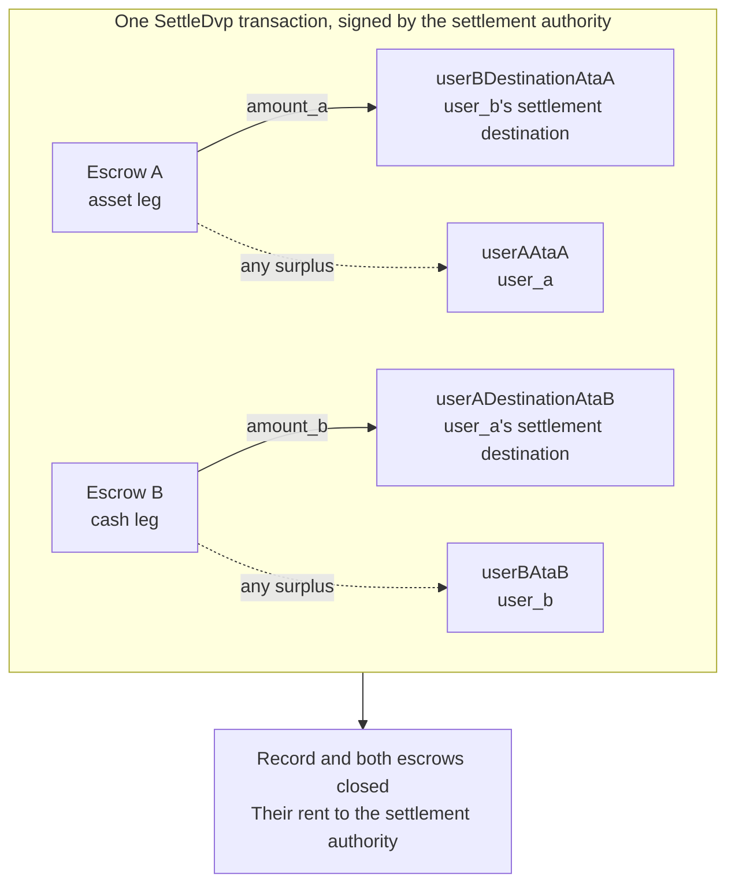

`SettleDvp` 由交易记录中指定的结算授权方签名。在一笔交易中,它会将资产腿的 `amount_a` 转入现金腿一方的目标账户,将现金腿的 `amount_b` 转入资产腿一方的目标账户,把任一托管账户中的多余部分退还给该腿所属的一方,并关闭交易记录和两个托管账户。若其中任何一笔转账无法完成,该指令会失败,且不会有任何资产发生移动。

本页承接[创建交易](/docs/defi/dvp-program/create-a-trade)和[为各腿注资](/docs/defi/dvp-program/fund-the-legs);客户端、签名者、`trade` 以及各方的 token account 均沿用。

## 签名前重新验证

结算授权方签名的这笔交易会转移两条腿的资产,因此它在签名前要像各参与方一样执行同样的读取检查:所有者、大小、参与方、mint、金额、到期时间以及两个目标账户(参见[为各腿注资](/docs/defi/dvp-program/fund-the-legs#verify-the-terms))。程序本身在结算时还会再次检查:每个 mint 是否仍属于创建时记录的 token program,是否不含被禁止的扩展,以及 mint authority 是否与创建交易时相同。因此,如果 mint 被重新创建后带有被禁止的扩展、使用了不同的 token program 或不同的 mint authority,则无法完成结算。

## 创建接收方账户

Settle 会写入四个程序不会创建的 token account:

| 账户                | 接收内容                     | 所有者                           |
| ---------------------- | ---------------------------- | ------------------------------- |
| `userADestinationAtaB` | 现金腿(`amount_b`)    | `user_a_settlement_destination` |
| `userBDestinationAtaA` | 资产腿(`amount_a`)   | `user_b_settlement_destination` |
| `userAAtaA`            | 资产腿的任何多余部分 | `user_a`                        |
| `userBAtaB`            | 现金腿的任何多余部分  | `user_b`                        |

只有当托管账户中的余额超过约定金额时,才会用到多余部分的接收账户。但任何持有该 mint 的人只需向托管账户转入几个最小单位,就能制造出多余部分。如果退款账户不存在,整个 Settle 就会失败,因此请在同一笔交易中以幂等方式创建全部四个账户。

<Tabs items={["TypeScript", "Rust"]}>
  <Tab value="TypeScript">
    ```ts
    import {
      findAssociatedTokenPda,
      getCreateAssociatedTokenIdempotentInstruction,
    } from "@solana-program/token-2022";

    const destinationA = t.userASettlementDestination; // defaults to userA
    const destinationB = t.userBSettlementDestination; // defaults to userB

    const [userADestinationAtaB] = await findAssociatedTokenPda({
      mint: mintB,
      owner: destinationA,
      tokenProgram: tokenProgramB,
    });
    const [userBDestinationAtaA] = await findAssociatedTokenPda({
      mint: mintA,
      owner: destinationB,
      tokenProgram: tokenProgramA,
    });
    // userAAtaA and userBAtaB are from fund the legs.

    const createRecipientAccounts = [
      { ata: userADestinationAtaB, owner: destinationA, mint: mintB, tokenProgram: tokenProgramB },
      { ata: userBDestinationAtaA, owner: destinationB, mint: mintA, tokenProgram: tokenProgramA },
      { ata: userAAtaA, owner: userA, mint: mintA, tokenProgram: tokenProgramA },
      { ata: userBAtaB, owner: userB, mint: mintB, tokenProgram: tokenProgramB },
    ].map(({ ata, owner, mint, tokenProgram }) =>
      getCreateAssociatedTokenIdempotentInstruction({
        payer: authoritySigner,
        ata,
        owner,
        mint,
        tokenProgram,
      }),
    );
    ```

  </Tab>

  <Tab value="Rust">
    ```rust
    use spl_associated_token_account_client::address::get_associated_token_address_with_program_id;
    use spl_associated_token_account_client::instruction::create_associated_token_account_idempotent;

    let authority: Pubkey = pubkey!("SETTLEMENT_AUTHORITY_ADDRESS_HERE");
    let destination_a = trade.user_a_settlement_destination; // defaults to user_a
    let destination_b = trade.user_b_settlement_destination; // defaults to user_b

    let user_a_destination_ata_b =
        get_associated_token_address_with_program_id(&destination_a, &mint_b, &token_program_b);
    let user_b_destination_ata_a =
        get_associated_token_address_with_program_id(&destination_b, &mint_a, &token_program_a);
    let user_a_ata_a = get_associated_token_address_with_program_id(&user_a, &mint_a, &token_program_a);
    let user_b_ata_b = get_associated_token_address_with_program_id(&user_b, &mint_b, &token_program_b);

    let create_recipient_accounts = [
        create_associated_token_account_idempotent(&authority, &destination_a, &mint_b, &token_program_b),
        create_associated_token_account_idempotent(&authority, &destination_b, &mint_a, &token_program_a),
        create_associated_token_account_idempotent(&authority, &user_a, &mint_a, &token_program_a),
        create_associated_token_account_idempotent(&authority, &user_b, &mint_b, &token_program_b),
    ];
    ```

  </Tab>
</Tabs>

## 结算

`legAExtrasCount` 用于告知程序:在固定列表之后追加的账户中,有多少个属于资产腿的 Transfer Hook,其余的则属于现金腿。对于没有 Transfer Hook 的 mint,传入零且不追加任何账户。memo program account 是该指令必需的账户,仅用于要求附带 memo 的目标账户。

<Tabs items={["TypeScript", "Rust"]}>
  <Tab value="TypeScript">
    ```ts
    import { MEMO_PROGRAM_ADDRESS } from "@solana-program/memo";
    import { getSettleDvpInstruction } from "./dvp";

    const settleInstruction = getSettleDvpInstruction({
      settlementAuthority: authoritySigner,
      swapDvp,
      mintA,
      mintB,
      dvpAtaA: escrowA,
      dvpAtaB: escrowB,
      userADestinationAtaB,
      userBDestinationAtaA,
      userAAtaA,
      userBAtaB,
      tokenProgramA,
      tokenProgramB,
      memoProgram: MEMO_PROGRAM_ADDRESS,
      legAExtrasCount: 0,
    });

    const { context: settleContext } = await client.sendTransaction([
      ...createRecipientAccounts,
      settleInstruction,
    ]);
    const settleSignature = settleContext.signature;
    console.log("Submitted:", settleSignature);

    // sendTransaction returns at the client's commitment (confirmed by default).
    // Wait for finalized before recording the trade as settled.
    let finalized = false;
    for (let attempt = 0; attempt < 30 && !finalized; attempt++) {
      const {
        value: [status],
      } = await client.rpc.getSignatureStatuses([settleSignature]).send();
      if (status?.err) {
        throw new Error("Settle transaction failed");
      }
      finalized = status?.confirmationStatus === "finalized";
      if (!finalized) {
        await new Promise((resolve) => setTimeout(resolve, 2_000));
      }
    }
    if (!finalized) {
      // A closed record means it settled; an open one is safe to settle again.
      throw new Error("Settle not finalized after 60s; read the trade record");
    }
    console.log("Settled:", settleSignature);
    ```

  </Tab>

  <Tab value="Rust">
    ```rust
    use dvp_swap_program_client::instructions::SettleDvpBuilder;

    const MEMO_PROGRAM_ID: Pubkey = pubkey!("MemoSq4gqABAXKb96qnH8TysNcWxMyWCqXgDLGmfcHr");

    let settle_ix = SettleDvpBuilder::new()
        .settlement_authority(authority)
        .swap_dvp(swap_dvp)
        .mint_a(mint_a)
        .mint_b(mint_b)
        .dvp_ata_a(escrow_a)
        .dvp_ata_b(escrow_b)
        .user_a_destination_ata_b(user_a_destination_ata_b)
        .user_b_destination_ata_a(user_b_destination_ata_a)
        .user_a_ata_a(user_a_ata_a)
        .user_b_ata_b(user_b_ata_b)
        .token_program_a(token_program_a)
        .token_program_b(token_program_b)
        .memo_program(MEMO_PROGRAM_ID)
        .leg_a_extras_count(0)
        .instruction();
    ```

  </Tab>
</Tabs>



### Transfer Hook

生成的 IDL 只列出固定账户,因此生成的构建器并不知道 hook 账户。请按照直接转移该代币时的相同方式,解析每个带 hook 的 mint 的额外账户元数据(account metas),然后将它们追加到指令中:先是资产腿的账户,再是现金腿的账户,并将 `legAExtrasCount` 设置为第一组的账户数量。在 TypeScript 中,将解析出的 metas 展开到指令的 `accounts` 数组中;在 Rust 中,使用构建器上的 `add_remaining_accounts`。每条腿的上限为 32 个账户,其中包括 hook 程序和验证账户;当两条腿都带有 hook 时,交易的账户数量上限可能会先达到。程序会移除所有转发账户的签名者标记,因此 hook 无法通过此路径获取结算授权方的签名。

## 记录结果

当 Settle 交易达到 `finalized` 状态时,才可将该交易视为已结算。结算后,交易记录和两个托管账户将不复存在,因此如果系统日后需要这些条款,应从结算前的读取结果或创建交易中保存。已关闭账户的 rent 已归还给结算授权方。

## Settle 错误

`LegNotFunded` 表示某个托管账户的余额低于约定金额;`DvpExpired` 和 `SettlementTooEarly` 表示错过了时间窗口;`MintAuthorityChanged` 和 `BlockedMintExtension` 表示某个 mint 在创建后发生了变化;`RecipientAtaMismatch` 表示目标账户或退款 token account 缺失,或不再属于预期的所有者和 mint,通常是因为跳过了上述创建账户的步骤。无论哪种情况,都不会有任何资产发生移动,各参与方可以撤销交易,但需受 mint 相关权限方的约束(参见[撤销交易](/docs/defi/dvp-program/unwind-a-trade))。

## 后续步骤

- [撤销交易](/docs/defi/dvp-program/unwind-a-trade):交易未能结算时,如何取回已注资的各腿资产
