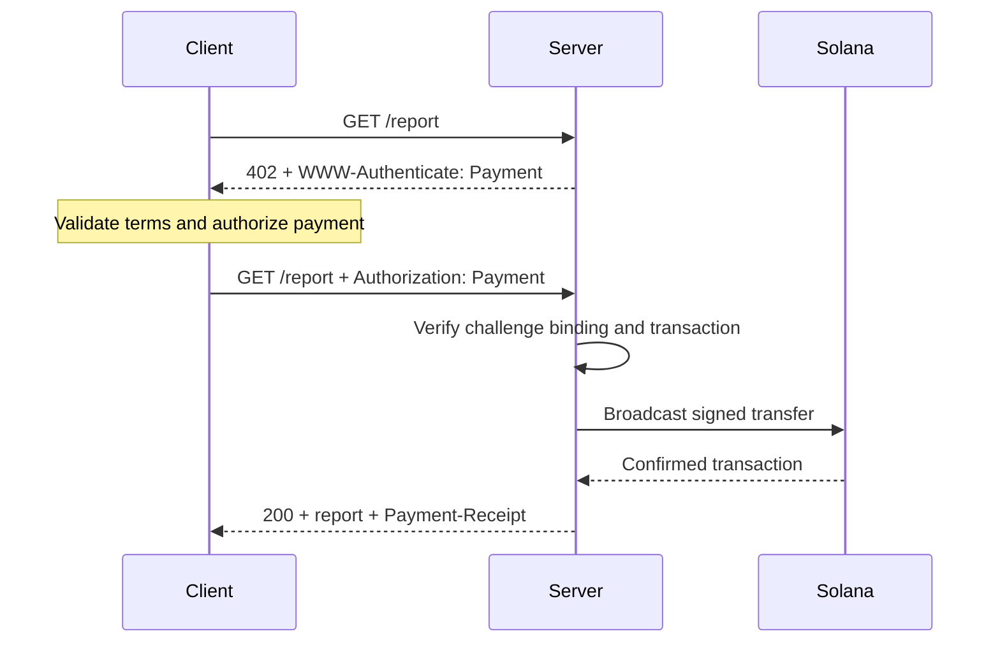
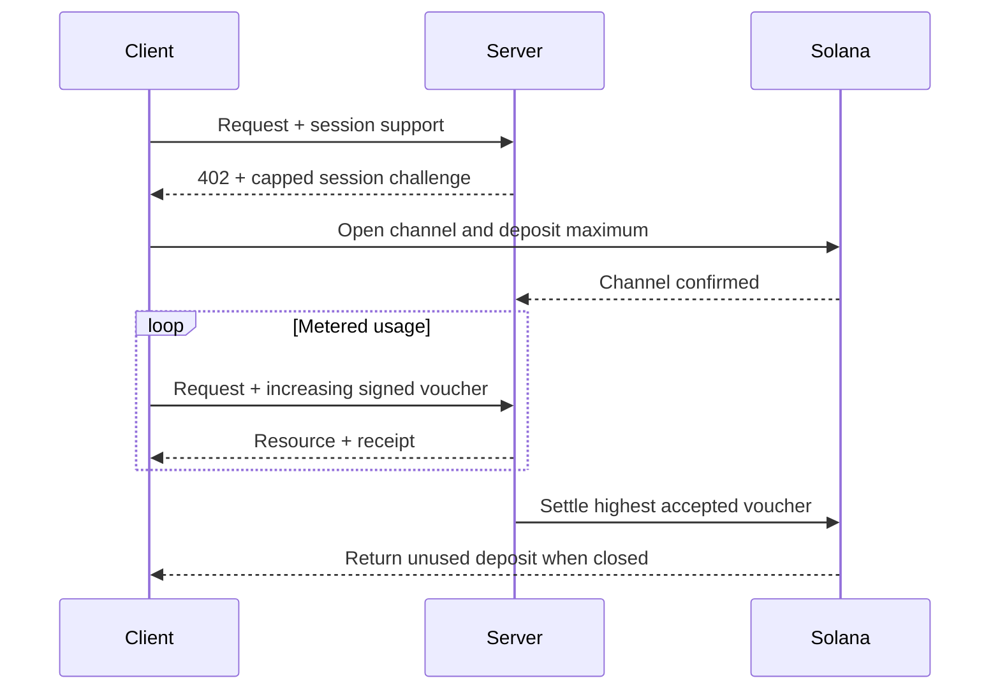

[机器支付协议（Machine Payments Protocol，MPP）](https://mpp.dev/)将 HTTP
认证语义应用于支付。服务器对未付款的请求发出质询，客户端返回支付凭证，服务器在
接受支付后返回收据。

MPP 将三个关注点分离：

- **意图（intent）** 描述商业交互，例如一次性的
  `charge` 或计量式的 `session`。
- **支付方式（payment method）** 描述价值如何流转。Solana 方式支持使用
  原生 SOL 和 SPL 代币进行收费。
- HTTP **传输层（transport）** 用于承载质询、凭证、收据和错误信息。

MPP 以一组 Internet-Draft（互联网草案）的形式发布。请以
[当前规范](https://paymentauth.org/)作为权威依据，并注意草案仍在制定中，
细节可能会发生变化。

## HTTP 交互

MPP 使用标准的 HTTP 认证字段，而不是特定于协议的
支付标头：

| 消息                 | HTTP 表示形式                                         |
| ----------------------- | ----------------------------------------------------------- |
| 支付质询       | `402 Payment Required`，并带有 `WWW-Authenticate: Payment ...` |
| 支付凭证      | 携带 `Authorization: Payment ...` 的重试请求           |
| 成功收据      | 带有 `Payment-Receipt: ...` 的资源响应               |
| 无效的支付详情 | 使用 `application/problem+json` 的 Problem Details 响应体       |



质询包含服务器生成的 ID、realm、方式、意图、编码后的
支付请求以及过期时间。凭证会回显该质询，并附加特定于支付方式的
支付证明。服务器必须同时验证这两部分；属于其他质询的有效
转账不得解锁该资源。

## Solana 一次性收费

Solana 的 `charge` 意图支持两种凭证类型：

- **拉取模式（Pull mode）** 使用已签名的交易。客户端签署转账并
  将交易发送给服务器。服务器进行验证，可选择性地添加
  手续费支付方签名，然后广播、确认，并在收据中返回交易
  签名。
- **推送模式（Push mode）** 使用交易签名。客户端先广播交易，再
  将已确认的签名发送给服务器。服务器在返回资源之前，会获取并验证
  该交易。

拉取模式支持由服务器代付交易手续费以及服务器端重试逻辑。
当钱包要求客户端自行提交交易时，推送模式会很有用，但它无法使用服务器代付手续费功能。

有关规范性字段和验证规则，请参阅
[Solana 收费规范](https://paymentauth.org/draft-solana-charge-00.html)。

## 为 Express API 添加 MPP 收费

Solana Pay Kit 提供了适用于 MPP 和 x402 的最新 TypeScript 集成。
请与 Express 一起安装：

```bash
pnpm add @solana/pay-kit @solana/kit@^6.9.0 express
pnpm add --save-dev @types/express tsx
```

这个最简示例使用托管的 Surfpool 沙盒和该软件包的公共
演示收款方。仅限本地开发使用：

```ts filename=server.ts
import express from "express";
import { createPayKit, usd } from "@solana/pay-kit";

const pay = await createPayKit({
  accept: ["mpp"],
  rpcUrl: "https://402.surfnet.dev:8899"
});

const app = express();

app.get("/report", pay.express(usd("0.01")), (_req, res) => {
  res.json({ report: "Paid report" });
});

app.listen(4567, () => {
  console.log("Paid API listening on http://127.0.0.1:4567");
});
```

运行它，并对比未付款请求与支持支付的请求：

```bash
pnpm tsx server.ts
curl -i http://127.0.0.1:4567/report
pay --sandbox curl http://127.0.0.1:4567/report
```

只有在中间件接受支付之后，路由处理程序才会运行。

<Callout type="warn" title="在生产环境中请替换所有沙盒默认设置">
  请配置明确的网络、商户收款方、专用 RPC、稳定的
  质询绑定密钥、生产环境签名者以及持久化的重放存储。切勿
  将真实支付路由到软件包自带的演示签名者。
</Callout>

## 计量会话

当客户端将进行许多小额、相关联的支付时，请使用 Solana MPP 的 `session`。
会话会开启一个设有最大存款额的链上支付通道，然后随着用量增长使用
累计的已签名凭据（voucher）。服务器可以在链下验证凭据，
并在之后结算已接受的最高金额。

这适用于按代币计量的推理、按字节计量的下载、实时数据
以及重复的工具调用。这与为每个事件单独发送一笔链上
支付并不相同。



请将会话称为**会话支付**、**支付通道**或**有上限的重复
授权**。只有当服务和支付合约确实对流式用量进行计量时，才可称之为流式支付。

## 生产环境验证

对于每一笔 Solana 收费，服务器至少必须验证：

- 质询真实有效、未过期、与此请求绑定，并且适用于
  此 realm。
- 交易使用了预期的网络、资产或铸币（mint）、收款方、金额
  以及代币程序。
- 任何手续费支付方或关联代币账户（associated token account）指令均已明确
  获得许可，并且不会耗尽服务器签名者的资金。
- 交易已在所需的确认级别上成功执行。
- 该交易签名尚未被消耗。
- 重放检查与消耗操作在所有服务器实例之间是原子性的。

对于会话，还应将通道状态、已接受的累计金额以及
结算水位线持久化到共享存储中。并说明如果服务器不可用，客户端
如何取回未使用的资金。

## 相关资源

- [MPP 规范](https://paymentauth.org/)
- [MPP 协议文档](https://mpp.dev/protocol)
- [Solana Pay Kit](https://github.com/solana-foundation/pay-kit)
- [智能体支付概述](/docs/payments/agentic-payments)
- [生产就绪](/docs/tools/security#verify-addresses)
