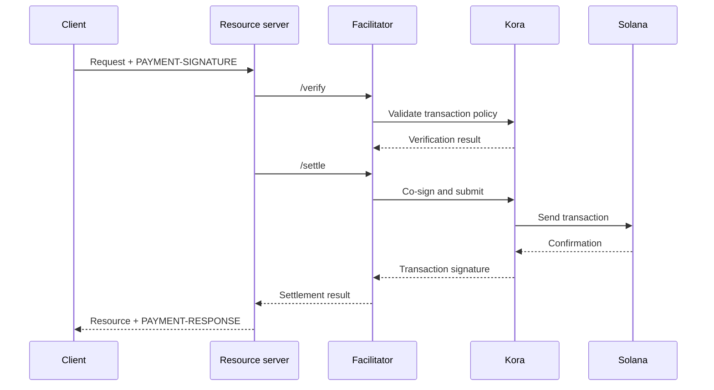

x402 facilitator 为一个或多个资源服务器执行支付验证和结算。它让 API 可以接收链上支付,而无需在每个应用进程中都加入 RPC、交易提交和手续费支付方(fee payer)的逻辑。

Facilitator 是一种架构角色,并不一定要由第三方担任。你可以使用托管服务,运营独立的 facilitator,也可以在资源服务器内部自行完成 facilitator 的工作。

## Facilitator 接口

x402 V2 定义了三种 HTTP 操作:

| 端点     | 用途                                                                       |
| ------------ | ----------------------------------------------------------------------------- |
| `/supported` | 列出支持的协议版本、方案、网络、扩展和签名者 |
| `/verify`    | 根据支付要求检查支付载荷,但不进行结算         |
| `/settle`    | 提交或完成支付,并返回结算结果            |

你的资源服务器应在启动或部署期间检查 `/supported`。在所选 facilitator 确认支持该确切的 x402 版本、方案和 Solana 网络之前,不要对外提供相应的支付选项。

```bash
curl https://facilitator.example/supported
```

## 先验证,再履行

安全的请求处理顺序如下:

1. 使用协议库解析 `PAYMENT-SIGNATURE` 载荷。
2. 将其与最初提供的确切 `PaymentRequirements` 进行匹配。
3. 在本地或通过 `/verify` 验证该载荷。
4. 仅当所选支付流程允许在履行之后再结算时,才执行资源操作。
5. 调用 `/settle`,并在 `PAYMENT-RESPONSE` 中返回结果。

不同方案可以定义不同的履行顺序。例如,授权流程可能在资源操作之前验证、在其之后结算,而另一种方案可能要求在履行之前先结算。请遵循所选方案声明的流程,而不要假定所有支付都采用同一种顺序。

<Callout type="warn" title="将 facilitator 的响应视为支付决策">
  对 facilitator 的流量进行身份验证,校验每一个响应,使用严格的超时设置,并在出错时默认拒绝(fail closed)。网络错误或格式错误的响应不能作为已付款的证明。
</Callout>

## 选择部署模式

| 模式                   | 适用场景                                                        | 主要职责                                                    |
| ----------------------- | --------------------------------------------------------------- | ---------------------------------------------------------------------- |
| 托管 facilitator     | 你希望运维范围尽可能小                       | 审查所支持的网络、信任模型、可用性和数据政策  |
| 专用自托管   | 多个 API 共享签名和结算基础设施        | 保护密钥、RPC、存储,并负责扩容和升级                      |
| 进程内 facilitation | 单个服务需要完全控制,并且能够运行链上组件 | 保持支付代码相互隔离,并防止请求负载将其耗尽 |

不要仅仅因为某个 facilitator 的 URL 能响应 `/supported` 就选择它。请审查它如何保护手续费支付方密钥、如何防止重放、如何确认交易、如何处理部分失败,以及如何通报事故。

## Kora:Solana 签名基础设施

[Kora](/docs/tools/kora) 是一个 Solana 签名节点,具备交易验证和手续费代付策略。x402 facilitator 可以将 Kora 用作其签名和提交后端:



Kora 并不取代 x402。资源服务器和 facilitator 仍需实现 x402 V2 的对象和端点;Kora 负责执行 Solana 交易策略,并保护其 RPC 接口背后的手续费支付方签名者。

请参阅 [Kora x402 指南](/docs/tools/kora/guides/x402),了解持续维护的演示和配置。

## 生产环境检查清单

### 密钥与交易策略

- 将 facilitator 和手续费支付方的密钥存放在硬件支持或远程的签名后端中。
- 仅根据所支持方案的需要,将 System、Compute Budget、Token、Token-2022 和 Associated Token 程序加入白名单。
- 在签名之前,拒绝意外的可写账户、转账授权方、收款方、mint、指令和计算价格。
- 将收款账户与运营用的手续费支付方账户分开。

### 重放与幂等性

- 将已使用的支付标识符和交易签名持久化到共享的持久存储中。
- 使验证与消耗操作具备原子性,避免两个服务器实例同时接受同一授权。
- 对有副作用的资源操作要求提供幂等键。
- 对于合法的重试,返回原始结果,而不是再次扣款。

### 可用性与故障处理

- 为 `/verify`、`/settle`、RPC 提交和确认设置有界的超时时间。
- 区分已拒绝、已过期、待处理、已确认和失败的结算。
- blockhash 过期后,未经付款方授权新交易,不要重新构建或重新签署交易。
- 使用多个 RPC 端点,并监控 blockhash 的新鲜度、确认延迟和手续费支付方余额。

### 可观测性

记录资源、挑战 ID、所选方案和网络、金额、资产、收款方、付款方地址、交易签名、确认级别、延迟和最终状态。切勿记录编码后的支付凭证、bearer token、私钥或原始的签名者响应。

对以下情况发出告警:结算失败、重放尝试、策略拒绝、意外的资产或收款方、手续费支付方余额耗尽,以及已验证支付与已履行资源之间的差异。

## 相关资源

- [x402 facilitator 规范](https://github.com/x402-foundation/x402/blob/main/specs/x402-specification-v2.md#7-facilitator-interface)
- [Solana 上的 x402](/docs/payments/agentic-payments/x402)
- [Kora 运营者指南](/docs/tools/kora/operators)
- [生产就绪度](/docs/tools/transaction-landing#rpc-infrastructure)
